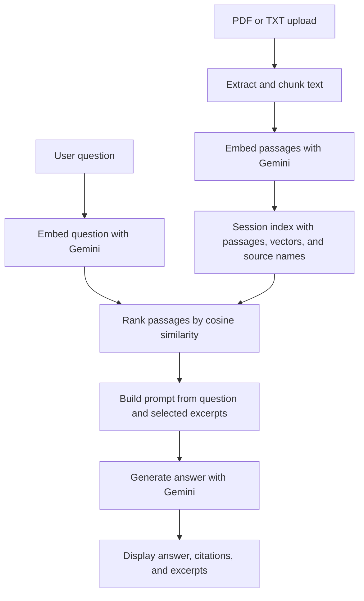

# Document Q&A Assistant

Upload up to five PDF or TXT files and ask questions about their contents. The app retrieves relevant passages, generates an answer with Gemini, and shows numbered citations alongside the passages so you can check the evidence.

**[Try the live demo](https://document-assistant-q.streamlit.app/)** — Upload a sample PDF or TXT file, ask a question, and check the cited passages.

## App preview


## Interface design

The Streamlit interface uses a full-page blue jellyfish background, a centered navy panel, ivory serif headings, and muted blue controls. The layout follows the order in which you use the app.

| State | What you see |
| --- | --- |
| First visit | A brief typing animation for **Ask your documents.**, the subtitle, and the uploader |
| Indexing | A progress spinner while the app extracts and embeds the uploaded text |
| Ready | File and passage counts, a question field, and the **Ask** button |
| Answer available | The answer, numbered citations, a retrieved-passage count, and an expandable list of passages |


## System design

The app uses retrieval-augmented generation (RAG). It indexes document text once for the current upload set, then retrieves passages for each question.



When the upload set changes, the app clears the previous index and answer. Follow-up questions reuse the current document vectors. The prompt asks for clarification on unfinished questions, cites the supporting passages, and reports when the retrieved evidence is insufficient.

## Run locally

From the repository root, install the dependencies.

```powershell
python -m pip install -r requirements.txt
```

If your checkout uses `req.txt`, substitute that filename in the install command. Create a local `.env` file with your Gemini API key and keep it ignored by Git.

```dotenv
GEMINI_API_KEY=your_key_here
```

Start the app.

```powershell
python -m streamlit run app.py
```

For Streamlit Community Cloud, configure `GEMINI_API_KEY` in the app’s Secrets settings.

## Project files

| Path | Purpose |
| --- | --- |
| `app.py` | Interface, file extraction, session state, and answer display |
| `embed_notes.py` | Chunking, Gemini API calls, cosine similarity, and prompt construction |
| `assets/jellyfish.png` | Interface background |
| `.streamlit/config.toml` | Streamlit theme settings, if included in your checkout |

## Document handling

The app extracts readable text from uploaded files. It sends text chunks to Gemini for embedding and sends the question and selected excerpts to Gemini for answer generation. Use public or sample files for the free-tier demo. Scanned PDFs need OCR before their text can be indexed.

## Roadmap

1. **Unit tests and CI.** Test text chunking, cosine similarity, retrieval order, citation mapping, and empty input with pytest. Mock Gemini calls and add a small set of questions with expected sources.
2. **Concurrent sessions.** Test simultaneous uploads and questions with separate users. Verify session isolation and rate-limit handling. Evaluate multiprocessing if profiling identifies PDF extraction as a CPU bottleneck.
3. **Context management.** Set a token budget for retrieved excerpts, keep citation labels intact, and reserve space for the question, instructions, and answer.
4. **Cost optimization.** Reuse embeddings for unchanged files within a session, evaluate batching, and compare API calls and token usage.
5. **Latency optimization.** Measure indexing and question-answering steps in server logs. Compare single-user and concurrent latency before and after changes, alongside retrieval and citation quality.
6. **More document formats.** Extend the current PDF and TXT support to Word (`.docx`), Markdown (`.md`), and PowerPoint (`.pptx`). Add OCR for scanned PDFs. Preserve source references such as section headings and slide numbers so users can verify citations. Add extraction and citation tests for each new format.
