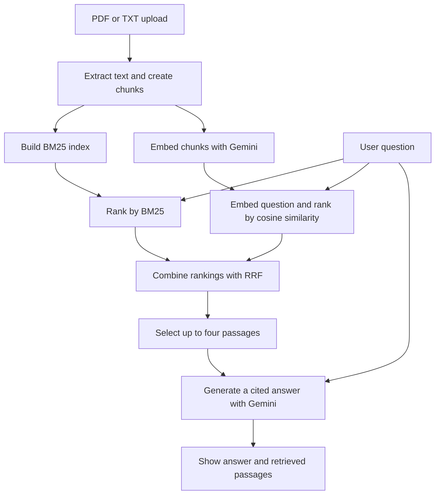

# Document Q&A Assistant

Upload up to five PDF or TXT files and ask questions about them. The app combines BM25 keyword search with semantic search, then uses Gemini to answer from the retrieved passages. Numbered citations let you check the evidence behind the answer.

**[Try the live demo](https://document-assistant-q.streamlit.app/)** · Upload a sample document and ask a question about it.

## App preview


## Interface design

The Streamlit interface uses a blue jellyfish background, a centered navy panel, ivory serif headings, and muted blue controls.

| State | What you see |
| --- | --- |
| First visit | The **Ask your documents.** heading and file uploader |
| Indexing | A spinner while the app extracts text, creates embeddings, and builds the BM25 index |
| Ready | File and passage counts, a question field, and the **Ask** button |
| Answer available | A generated answer, numbered citations, and an expandable list of retrieved passages |

## How it works

The app uses retrieval-augmented generation (RAG) with hybrid retrieval. Both search methods work on the **same document chunks**, so each result can be traced back to its text and source filename.



1. **Index the upload.** The app extracts readable text, splits it into chunks, builds a BM25 index, and creates an embedding for each chunk. It stores the chunks, vectors, source filenames, and BM25 index in the current Streamlit session. Changing the uploaded files clears that state and the previous answer.
2. **Search two ways.** BM25 ranks passages containing query terms. Semantic search embeds the question and ranks passages by cosine similarity. Each method returns up to 10 candidate chunk positions.
3. **Fuse the rankings.** Reciprocal Rank Fusion (RRF) adds a contribution of `1 / (60 + rank)` from each ranking where a chunk appears. Ranks start at 1. The app takes up to four chunks from the combined ranking.
4. **Generate and cite the answer.** Gemini receives the question and the selected, numbered excerpts. The prompt asks it to cite supporting passages, ask for clarification when needed, and say when the evidence is insufficient. The UI displays the same excerpts so users can verify the citations.

## Run locally

From the repository root, install the dependencies:

```powershell
python -m pip install -r requirements.txt
```

Create a `.env` file in the repository root and add your Gemini API key. Keep `.env` out of Git.

```dotenv
GEMINI_API_KEY=your_key_here
```

Start the app:

```powershell
python -m streamlit run app.py
```

For Streamlit Community Cloud, configure `GEMINI_API_KEY` in the app’s Secrets settings.

### Try it with the sample notes

Upload `notes.txt`, then try these questions:

| Question | What it exercises |
| --- | --- |
| Which AWS service stores photos? | Keyword matches and a cited answer about Amazon S3 |
| Where can I keep pictures? | Semantic matching between `pictures` and `photos` |
| How much does S3 cost? | How the app responds when the uploaded notes lack the requested detail |

## Project files

| Path | Purpose |
| --- | --- |
| `app.py` | Streamlit interface, text extraction, session state, and answer display |
| `bm25_search.py` | Tokenization, BM25 index construction, and keyword ranking |
| `embed_notes.py` | Chunking, Gemini embeddings, cosine-similarity ranking, and answer generation |
| `hybrid_search.py` | Runs both retrievers and combines their rankings with RRF |
| `notes.txt` | Sample AWS notes for trying the app locally |
| `requirements.txt` | Python dependencies |
| `assets/jellyfish.png` | App background |
| `assets/interface.png` | README screenshot |
| `.streamlit/config.toml` | Streamlit theme settings |

## Document handling

The app sends extracted text chunks to Gemini for embedding. When you ask a question, it sends the question for semantic retrieval and sends the question with the selected excerpts for answer generation. BM25 runs locally in the app process. Use public or sample files in the live demo.

The app reads the text layer of PDFs. Scanned PDFs need OCR before their text can be indexed. Large uploads create more embedding requests and can hit Gemini’s rate limits.

## Roadmap

1. **Unit tests and CI** — Test chunking, BM25 ranking, cosine similarity, RRF, citation mapping, and empty inputs. Mock Gemini calls in automated tests.
2. **Retrieval evaluation** — Compare BM25-only, semantic-only, and hybrid retrieval on the same questions with known source passages. Use Recall@4 to check how much of the expected evidence reaches the model.
3. **Concurrent sessions** — Test simultaneous uploads and questions, session isolation, and rate-limit handling. Profile PDF extraction before deciding whether to parallelize it.
4. **Context management** — Set a token budget for retrieved excerpts while preserving citation labels and room for the question and answer.
5. **Cost and latency** — Measure indexing and question-answering separately. Evaluate embedding reuse across upload changes, batching, and request pacing.
6. **More document formats** — Add Word, Markdown, PowerPoint, and OCR support. Preserve section headings and slide numbers for citations.