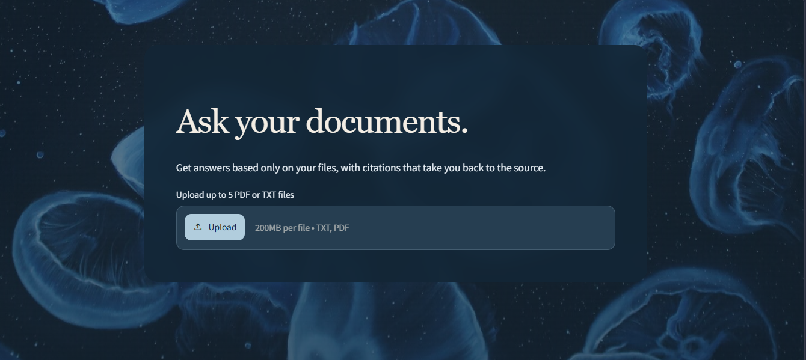
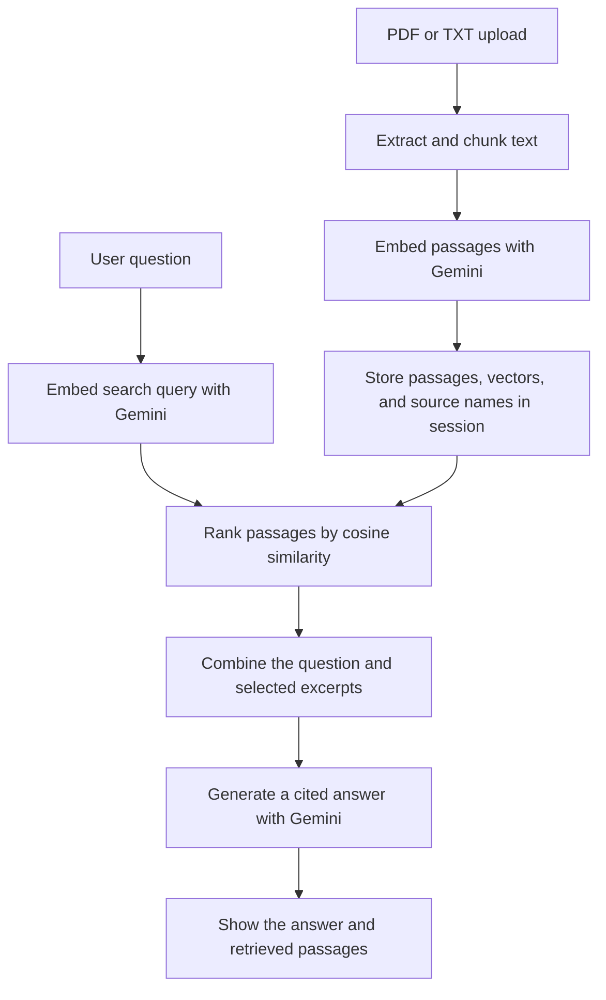

# Document Q&A Assistant

Upload up to five PDF or TXT files and ask questions about them. The app retrieves relevant passages, generates an answer with Gemini, and displays numbered citations so you can check the evidence.

**[Try the live demo](https://document-assistant-q.streamlit.app/)** — Upload a sample document and ask a question about it.

## App preview



## Interface design

The Streamlit interface uses a blue jellyfish background, a centered navy panel, ivory serif headings, and muted blue controls.

| State | What you see |
| --- | --- |
| First visit | The **Ask your documents.** heading, a subtitle, and the uploader |
| Indexing | A spinner while the app extracts and embeds the text |
| Ready | File and passage counts, a question field, and the **Ask** button |
| Answer available | The answer, numbered citations, and an expandable list of retrieved passages |

## System design

The app uses retrieval-augmented generation (RAG). It builds an index for the current upload set and reuses the document embeddings for follow-up questions.



When the upload set changes, the app clears the previous index and answer. The prompt asks Gemini to clarify unfinished questions, cite supporting passages, and identify gaps in the retrieved evidence.

## Run locally

From the repository root, install the dependencies.

```powershell
python -m pip install -r requirements.txt
```

If your checkout uses `req.txt`, use that filename in the install command. Create a local `.env` file with your Gemini API key and keep it ignored by Git.

```dotenv
GEMINI_API_KEY=your_key_here
```

Start the app.

```powershell
python -m streamlit run app.py
```

For Streamlit Community Cloud, set `GEMINI_API_KEY` in the app’s Secrets settings.

## Project files

| Path | Purpose |
| --- | --- |
| `app.py` | Streamlit interface, file extraction, and session state |
| `embed_notes.py` | Chunking, Gemini API calls, passage ranking, and prompt construction |
| `assets/jellyfish.png` | App background |
| `assets/interface.png` | README screenshot |
| `.streamlit/config.toml` | Streamlit theme settings, if present |

## Document handling

The app sends extracted text chunks to Gemini for embedding. For answer generation, it sends the question and selected excerpts. Use public or sample documents in the free-tier demo. Scanned PDFs need OCR before the app can index their text.

## Roadmap

1. **Unit tests and CI.** Use pytest to test chunking, cosine similarity, retrieval order, citation mapping, and empty input. Mock Gemini calls and add sample questions with expected sources.
2. **Concurrent sessions.** Test simultaneous uploads and questions. Verify that each session isolates its documents and handles API rate limits. Evaluate multiprocessing if profiling shows that PDF extraction is a CPU bottleneck.
3. **Context management.** Set a token budget for retrieved excerpts, preserve citation labels, and reserve space for the question, instructions, and answer.
4. **Cost optimization.** Reuse embeddings for unchanged files within a session. Evaluate batching and compare API call counts and token usage.
5. **Latency optimization.** Measure indexing and question-answering latency in server logs. Compare performance under single-user and concurrent use, alongside retrieval and citation quality.
6. **More document formats.** Add Word (`.docx`), Markdown (`.md`), and PowerPoint (`.pptx`) support, plus OCR for scanned PDFs. Preserve section headings and slide numbers for citations and test each format.